# reverse-of-power-web

Play **Knowledge is Power** and **Knowledge is Power: Decades** on a PS4 or PS5 from any phone browser, Android or iPhone. No app install is needed.

This is a web port of [synchrone/reverse-of-power](https://github.com/synchrone/reverse-of-power), an Android replacement for Sony's PlayLink app. A phone browser can't send the raw UDP the console speaks, so a small relay runs on a computer on the same network and translates between the phones (WebSocket) and the console (UDP).

```
phones (browser) ──WebSocket──> kip-relay.mjs on a home computer ──UDP 9066/9060──> PS4/PS5
```

## Play

1. Install [Node.js](https://nodejs.org) (tested with v24) on a computer on the same Wi-Fi as the console.
2. Copy `dist/kip-relay.mjs` to it. It is a single file with no dependencies, and it contains the whole phone app.
3. Run `node kip-relay.mjs`. On Windows, accept the administrator prompt. That lets more than one phone join (see below).
4. Start the game on the TV and go to the join screen.
5. Each player scans the QR code the relay prints, or opens the address it shows (for example `http://192.168.1.20:8080/`).
6. Tap the PlayStation in the list. The phone then follows the TV: name, selfie, avatar, hold to start.

Options:

| Option | Meaning |
|---|---|
| `--port 8080` | HTTP/WebSocket port for the phones |
| `--console 192.168.1.50` | Console IP, if discovery doesn't find it |
| `--single` | One phone only; never touches network settings |
| `--no-elevate` | Don't ask for administrator rights |
| `--verbose` | Log every protocol message |

### Why administrator rights

The console accepts one player per IP address. To let several phones join through one computer, the relay adds a temporary extra IP address on the computer's network adapter for each extra phone and removes them on exit. On Windows it first enables `dhcpstaticipcoexistence`, so the adapter keeps its normal DHCP address. Without administrator rights, only one phone can play.

If your network ever misbehaves after a crash, this restores Windows to plain DHCP:

```
netsh interface ipv4 set address "Wi-Fi" source=dhcp
netsh interface ipv4 set dnsservers "Wi-Fi" source=dhcp
```

macOS (`ifconfig alias`) and Linux (`ip addr add`) are supported with `sudo` but have only been tested on Windows.

## What it adds over the Android app

- Runs in any phone browser, with an install prompt to add it to the home screen.
- Sound effects, synthesised in the browser.
- Visuals for every power play, including lockdown, bugs, disco and the double-trouble combinations.
- A face guide on the selfie, so the console's costume masks line up.
- Reconnects mid-game: a reload or a dropped Wi-Fi connection returns to the current screen. If a phone is offline when the console asks for its power play or category choice, the relay answers for it, so the room doesn't stall.

Known limitations:

- The relay serves plain HTTP on the LAN, so browsers block the service worker and the native install prompt. Install uses the browser's "Add to Home Screen" instructions.
- The selfie uses the phone's camera picker, not a live preview like the Android app.
- iPhone Safari doesn't allow fullscreen for web pages unless the app is added to the home screen.

## Screenshots

| | |
|---|---|
| 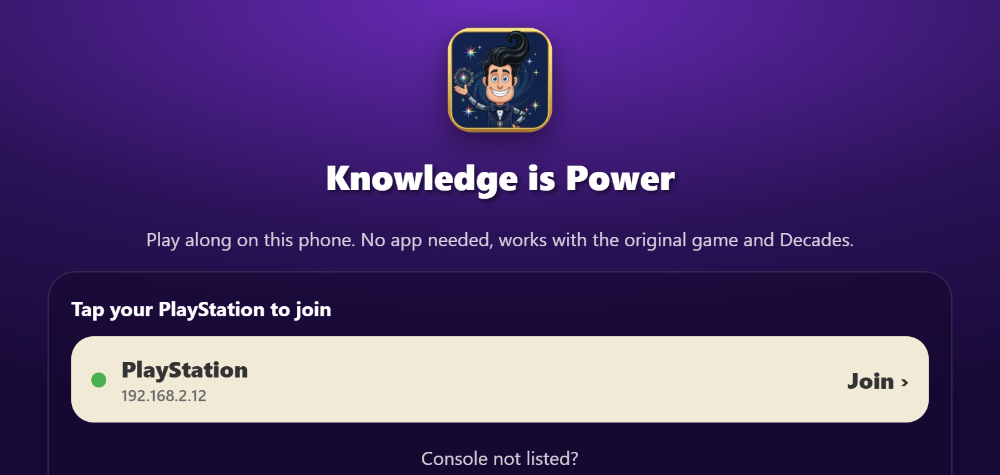 | 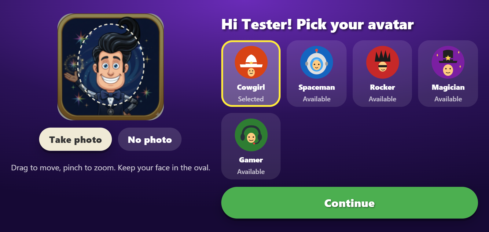 |
| 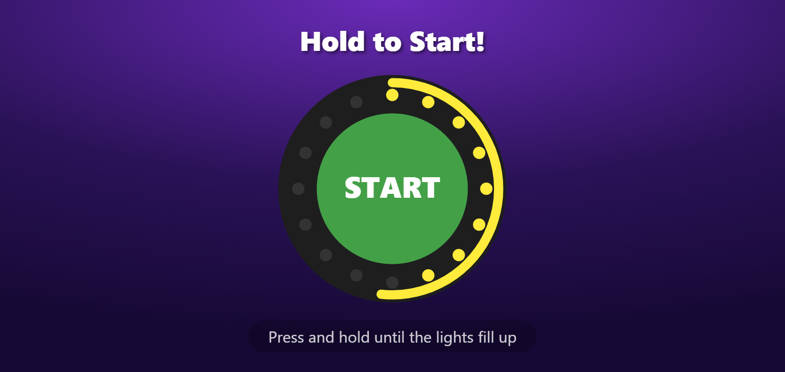 |  |
| 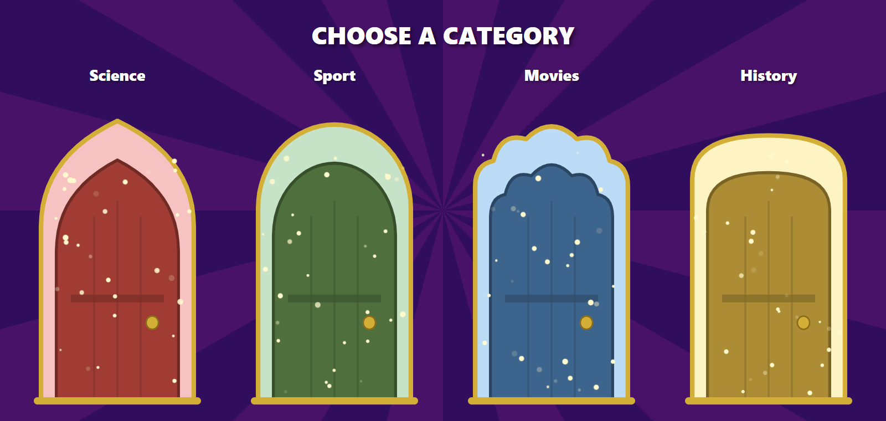 | 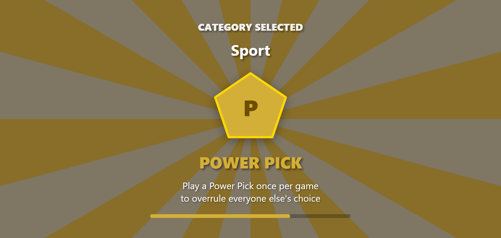 |
| 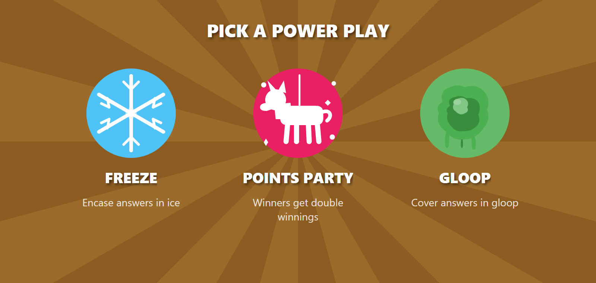 | 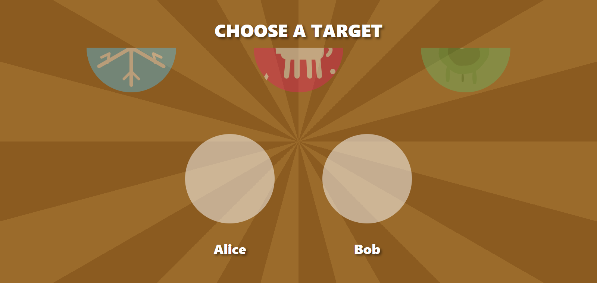 |
| 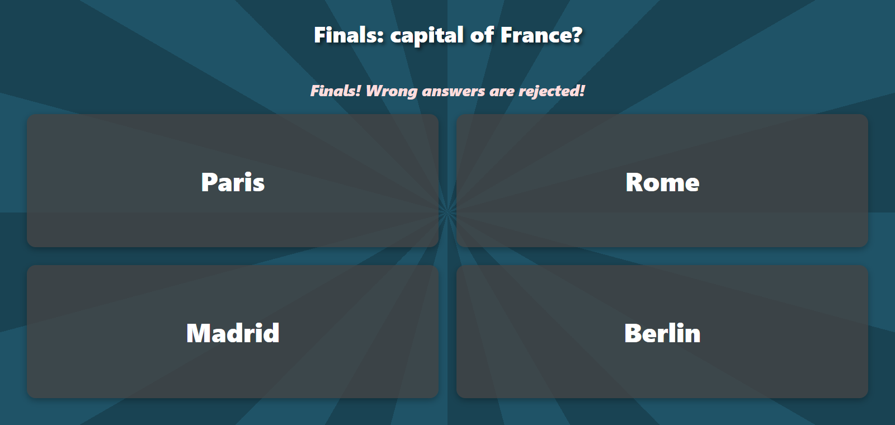 | 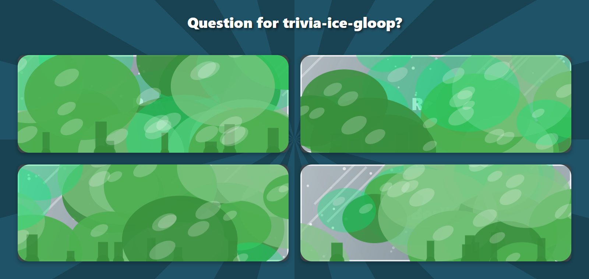 |
| 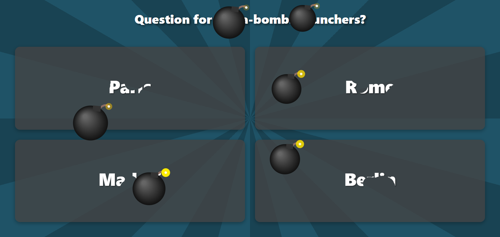 | 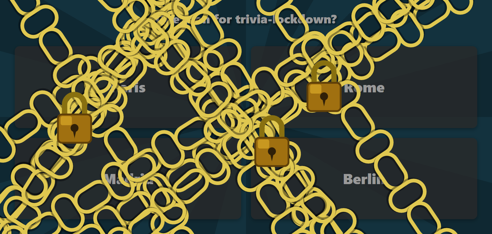 |
| 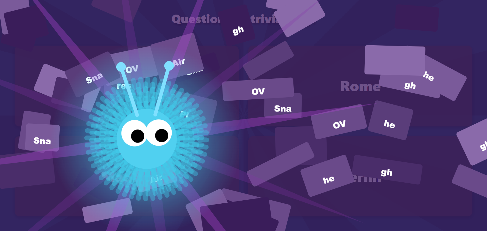 | 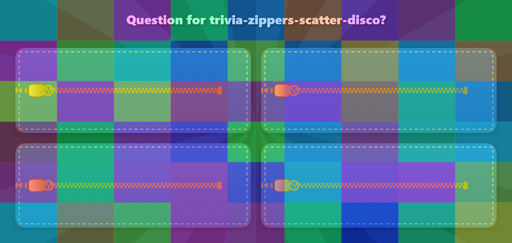 |
| 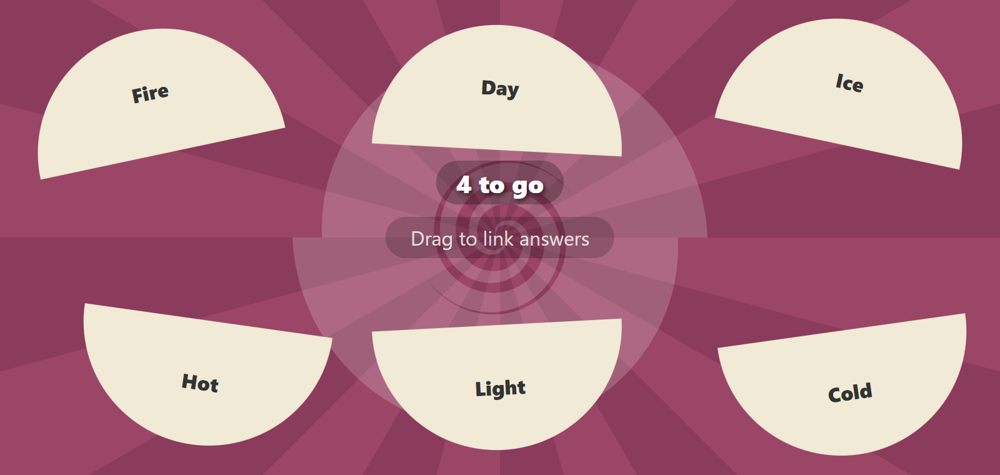 | 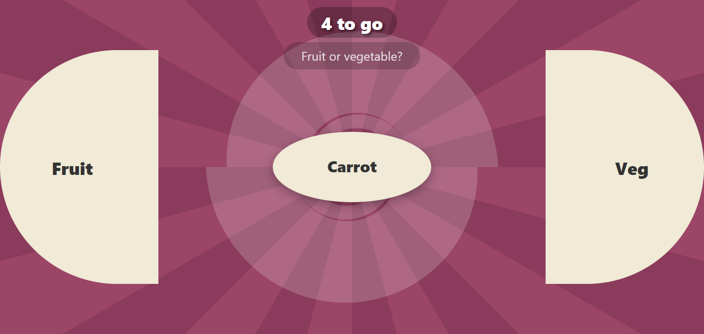 |
| 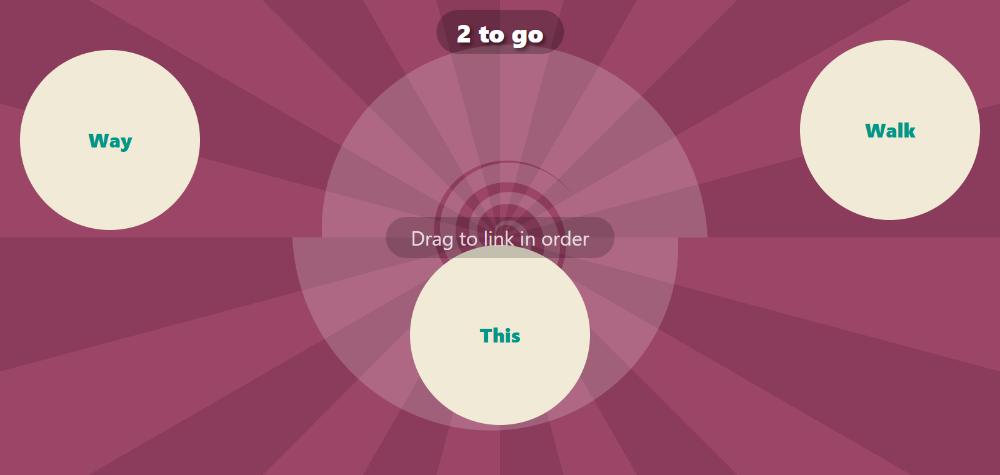 | 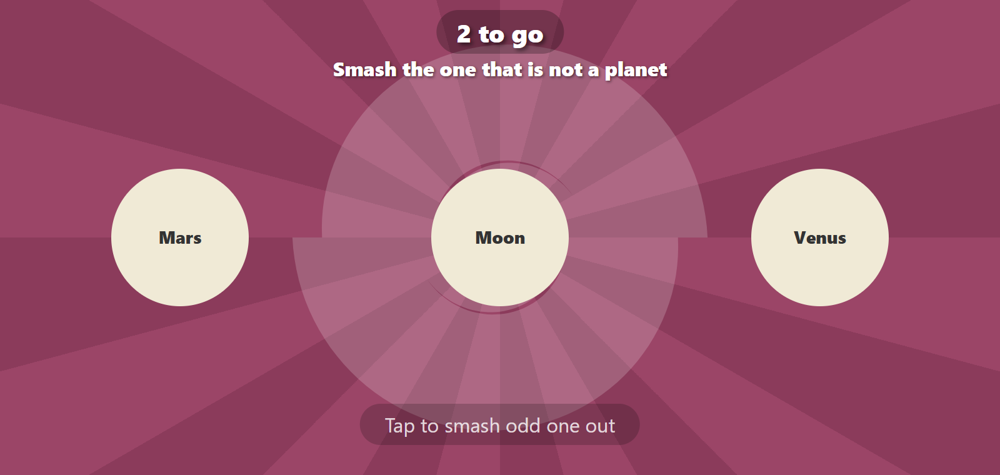 |
| 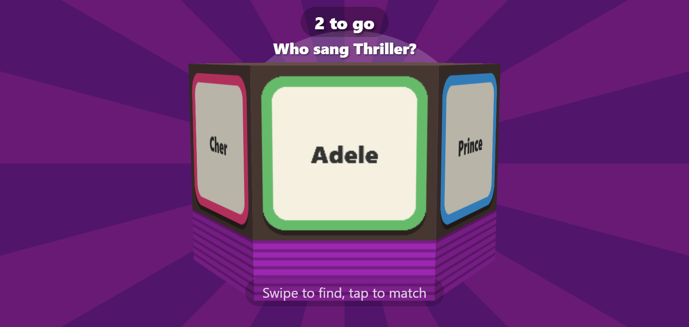 | 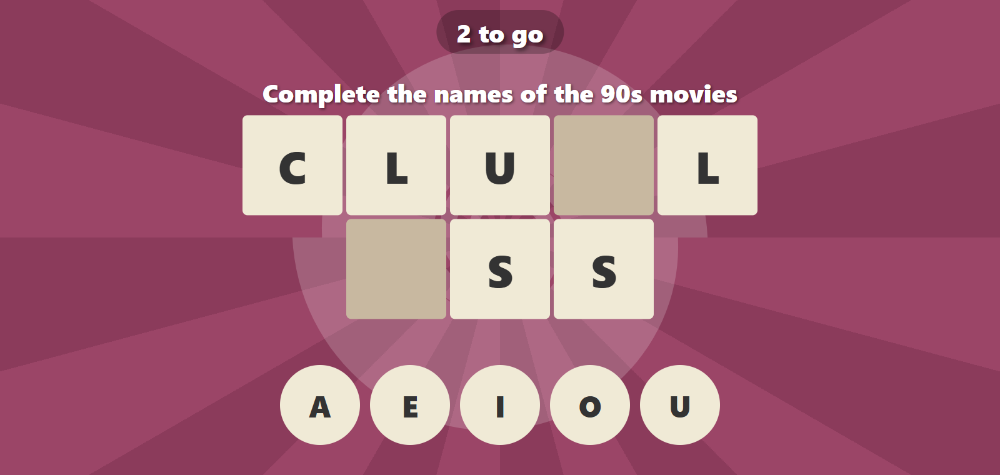 |
| 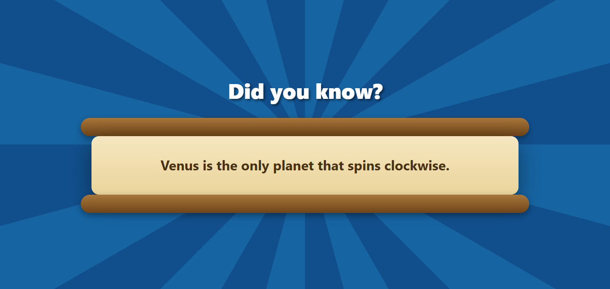 | |

## Develop

```
node build.mjs        # writes dist/index.html and dist/kip-relay.mjs
```

The phone app is plain JavaScript in `src/web/`: screens in `js/screens-*.js`, effects in `js/effects.js`, styles in `styles.css`. `build.mjs` inlines everything into one HTML file and embeds it in the relay. `src/web/generated/` holds the artwork converted from the Android vector drawables (`tools/convert-drawables.mjs`).

Tests run a whole game without a console:

```
npm install
node test/qr-check.cjs
powershell -ExecutionPolicy Bypass -File test\run-e2e.ps1 -Ip <this PC's LAN IP> -Mode kip
powershell -ExecutionPolicy Bypass -File test\run-e2e.ps1 -Ip <this PC's LAN IP> -Mode decades
powershell -ExecutionPolicy Bypass -File test\run-e2e.ps1 -Ip <this PC's LAN IP> -Mode kip -Script offline
```

`test/fake-console.mjs` plays a scripted game over the real UDP protocol, `test/e2e.mjs` drives a phone in headless Chrome, and screenshots land in `test/shots-<script>/`. Set `CHROME_PATH` if Chrome isn't in the default Windows location. See `NOTES.md` for what was learned along the way.

`probe/kip-probe.mjs` is the tool that proved a console accepts several players from one computer when each has its own IP address.

## License

GPL-3.0, like the project it is derived from. Protocol knowledge, factoids and artwork come from [synchrone/reverse-of-power](https://github.com/synchrone/reverse-of-power).
